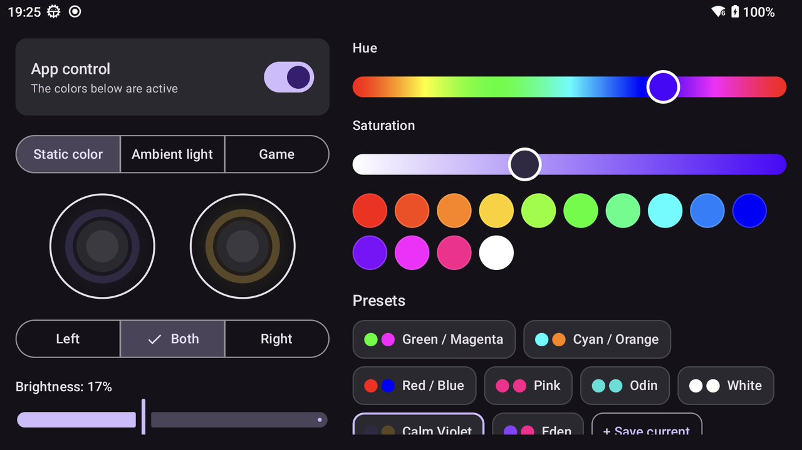

<p align="center">
  
</p>

<h1 align="center">AmbiAnalog</h1>

<p align="center">
  Joystick LED control for the <b>AYN Thor</b> - static colors, ambient light and colors that follow your game.
</p>

<p align="center">
  <a href="https://github.com/mkaflowski/AmbiAnalog/releases/latest"></a>
  <a href="https://github.com/mkaflowski/AmbiAnalog/releases"></a>
</p>

<p align="center">
  
</p>

## Features

- **Static colors** - a color per stick, brightness, built-in and your own presets.
- **Ambient light** - the sticks follow the left and right half of the top screen.
- **Game mode** - colors from the cover of the game you're playing (Cocoon artwork for Eden, Azahar, RetroArch and other emulators), from Android game icons, or your own colors per game. Switching games fades smoothly.
- **Quick Settings tile** - dim the LEDs, or bring the app back after Android closed it. Long-press opens the app on the bottom screen.
- **Extended mode** (optional) - pairs with the Thor's own wireless debugging, like Shizuku, so your colors stay after the app is closed or the device restarts.

English and Polish.

## Install

Download the APK from [Releases](https://github.com/mkaflowski/AmbiAnalog/releases/latest) and install it on the Thor.

Optional, once, from a computer:

```bash
# Extended mode: lets the app switch wireless debugging on only while it needs it
adb shell pm grant pl.mateuszkaflowski.ambiled android.permission.WRITE_SECURE_SETTINGS
# Ambient light: starts without the screen capture consent dialog
adb shell appops set pl.mateuszkaflowski.ambiled PROJECT_MEDIA allow
```

Then open **Extended mode** in the app and pair it with wireless debugging.

### Extended mode without Wi-Fi

After pairing once, the Thor can run the full extended mode offline, including ROM detection
and saving colors to the system. Enable persistent ADB TCP from a computer:

```bash
adb shell setprop persist.adb.tcp.port 5555
adb tcpip 5555
```

Keep **USB debugging** enabled so adbd starts on boot; a USB cable is not needed afterwards.
The app automatically prefers the configured TCP port on `127.0.0.1`, using the same pairing
key, and falls back to wireless debugging if TCP is unavailable. Test the connection in
**Extended mode** with Wi-Fi off, including after a reboot. Persistent TCP depends on the
device firmware; this setup is intended for the Thor.

The TCP listener is device-wide, remains enabled when the app closes, and listens on network
interfaces too. ADB key authorization remains enabled; the app itself connects over loopback.
To turn TCP off and return to wireless debugging:

```bash
adb shell setprop persist.adb.tcp.port -1
adb usb
```

If Android forgets pairing after a long break, disable its ADB authorization timeout once:

```bash
adb shell settings put global adb_allowed_connection_time 0
```

This applies to all saved ADB keys. Pair again if Android has already removed the app's key.

### Building with an existing debug signing key

To update an existing installation from another computer without losing its data:

```bash
./gradlew assembleRelease -PambianalogKeystore=/path/to/debug.keystore
```

The key must match the installed APK. The default Android debug alias and passwords are used.

## Notes

- Made for the AYN Thor (Android 13). The app drives the joystick LED controllers directly, so a firmware update could change how it works.
- It probably also works on other AYN devices with joystick LEDs, such as the Odin series, but I haven't tested it.
- Not affiliated with AYN. Use at your own risk.
